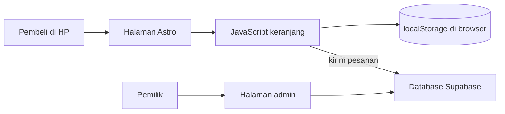

# PRD: Webapp Pemesanan House of Tigara

## 1. Overview
Webapp pemesanan untuk House of Tigara, brand Market Day mahasiswa di Telkom University Jakarta (Instagram @houseoftigara). Pembeli membuka halaman dari HP, memilih Risol Mayo, Coffee Bun, atau Matcha, lalu mengirim pesanan tanpa membuat akun.

- **Pengguna utama:** pembeli (mahasiswa dan pengunjung Market Day) dan pemilik brand yang menerima pesanan.
- **Masalah:** pembeli malas menunggu. Sinyal kampus bisa tidak stabil, dan antrean pesan manual memakan waktu.
- **Tanda berhasil:** pembeli bisa mengirim pesanan dari buka halaman sampai konfirmasi dalam maksimal 4 langkah, dan halaman terasa langsung terbuka di HP.
- **Titik awal:** landing page Astro yang sudah ada dipakai sebagai dasar.
- **Waktu pakai:** Market Day Desember 2026.

## 2. Requirements
- R1. Pembeli bisa melihat daftar menu (3 produk) dengan harga.
- R2. Pembeli bisa menambah produk ke keranjang dan mengubah jumlahnya.
- R3. Pembeli bisa mengirim pesanan tanpa akun atau login, dalam maksimal 4 langkah.
- R4. Pesanan tersimpan dan bisa dilihat pemilik brand.
- R5. Halaman cepat dibuka di HP. Keranjang tidak hilang kalau sinyal putus, dan pesanan bisa dikirim ulang.
- R6. Tampilan sesuai brand: elegan, premium, hangat, warna ivory dan olive, huruf serif.
- R7. Pembeli melihat konfirmasi setelah pesanan terkirim.
- R8. Cara bayar sesuai pilihan pemilik: [isi: QRIS].

**Batasan**
- Dikerjakan sendiri oleh pemula, jadi kode harus sederhana dan mudah dibaca.
- Pola pemesanan: [isi: pre-order].
- Harga: [isi: harga risol mayo 1 box isi 4 pcs Rp. 15.000, Coffe Bun Rp. 12.000, Matcha Rp. 16.000].
- Hosting dan anggaran: [isi: gratis].
- Target kecepatan (usulan, bisa diganti): skor Lighthouse mobile Performance di atas 90, JavaScript di bawah 50 KB, halaman menu terbuka dalam 2 detik di jaringan 4G.

**Di luar cakupan**
- Login atau akun pembeli.
- Pembayaran otomatis lewat payment gateway.
- Program poin atau voucher.
- Banyak bahasa.
- Aplikasi HP khusus (Android atau iOS).

## 3. Core Features
- **Fase 1: Pesan dasar (R1, R2, R3, R4, R6, R7).**
  Halaman menu dengan 3 produk dan harga, tombol tambah ke keranjang, keranjang dengan ubah jumlah dan total, form pesan (nama dan [isi: kontak, misalnya nomor WhatsApp]), pesanan tersimpan ke database, halaman konfirmasi. Fase ini sudah bisa dipakai menerima pesanan.
- **Fase 2: Bayar dan tahan sinyal lemah (R5, R8).**
  Instruksi pembayaran sesuai [isi: metode bayar], keranjang tersimpan di HP sehingga tidak hilang saat halaman dimuat ulang, pesan error dan tombol "Coba kirim lagi" kalau pengiriman gagal.
- **Fase 3: Pemilik dan kecepatan (R4, R5).**
  Halaman daftar pesanan untuk pemilik (dengan kata sandi sederhana), tombol ubah status pesanan, optimasi gambar dan huruf, pengukuran kecepatan dengan Lighthouse, deploy final.

## 4. User Flow
- **Fase 1 (pembeli):**
  1) Buka halaman menu. 2) Klik "Tambah" pada produk yang diinginkan. 3) Buka keranjang, cek jumlah dan total, lalu isi nama dan kontak. 4) Klik "Kirim Pesanan" dan lihat halaman konfirmasi.
  *Kondisi gagal:* kalau nama atau kontak kosong, tampilkan "Isi nama dan kontak dulu". Kalau keranjang kosong, tombol kirim tidak aktif.
- **Fase 2 (pembeli):**
  1) Setelah kirim pesanan, pembeli melihat instruksi bayar. 2) Kalau sinyal putus saat mengirim, muncul pesan "Pesanan belum terkirim". 3) Pembeli klik "Coba kirim lagi" dan isi keranjang masih utuh.
  *Kondisi gagal:* kalau tetap gagal, tampilkan [isi: kontak darurat, misalnya WhatsApp/Instagram House of Tigara] sebagai jalan lain.
- **Fase 3 (pemilik):**
  1) Pemilik buka halaman admin. 2) Masukkan kata sandi. 3) Lihat daftar pesanan terbaru. 4) Ubah status (baru, diproses, selesai).
  *Kondisi gagal:* kata sandi salah, tampilkan "Kata sandi salah" dan jangan tampilkan pesanan.

## 5. Architecture

- **Halaman Astro:** menampilkan menu sebagai HTML biasa. Ini membuat halaman cepat terbuka dan hampir tanpa JavaScript (R5).
- **JavaScript keranjang:** bagian interaktif untuk keranjang dan form. Pesanan dikirim ke endpoint server Astro `/api/orders`; secret Supabase hanya dibaca server dari `SUPABASE_URL` dan `SUPABASE_SECRET_KEY` (tanpa prefix `PUBLIC_`). Endpoint memakai Supabase client server-side untuk memanggil RPC `create_order_atomic`.
- **localStorage:** menyimpan isi keranjang di HP supaya tidak hilang saat sinyal putus atau halaman dimuat ulang (R5).
- **Database Supabase:** menyimpan pesanan dan bisa dibaca pemilik (R4). Ini usulan karena gratis untuk mulai dan tidak perlu menulis server sendiri.
- **Halaman admin:** dipakai pemilik melihat dan mengubah status pesanan (R4).

## 6. Database Schema
Tiga tabel. Tanda "Fase" menunjukkan kapan field mulai dipakai.

**products** (daftar menu)

| Field | Tipe | Arti | Fase |
|---|---|---|---|
| id | teks | ID unik produk | 1 |
| name | teks | Nama produk, contoh: Risol Mayo | 1 |
| price | angka | Harga dalam rupiah, [isi: harga per produk] | 1 |
| is_available | benar/salah | Produk masih tersedia atau habis | 3 |

**orders** (satu baris per pesanan)

| Field | Tipe | Arti | Fase |
|---|---|---|---|
| id | teks | ID unik pesanan | 1 |
| customer_name | teks | Nama pembeli | 1 |
| contact | teks | [isi: nomor WhatsApp] | 1 |
| total | angka | Total harga dalam rupiah | 1 |
| created_at | waktu | Kapan pesanan dikirim | 1 |
| payment_method | teks | Cara bayar, [isi: sesuai keputusan R8] | 2 |
| status | teks | baru, diproses, atau selesai | 3 |

**order_items** (isi tiap pesanan)

| Field | Tipe | Arti | Fase |
|---|---|---|---|
| id | teks | ID unik baris | 1 |
| order_id | teks | Menunjuk ke pesanan di tabel orders | 1 |
| product_id | teks | Menunjuk ke produk di tabel products | 1 |
| quantity | angka | Jumlah yang dipesan | 1 |
| price_at_order | angka | Harga saat dipesan, supaya perubahan harga tidak mengubah pesanan lama | 1 |

Contoh satu pesanan: `{ "customer_name": "Contoh", "total": [isi], "items": [{ "product": "Matcha", "quantity": 2 }] }`

Keranjang di browser memakai key `cart` di localStorage: `[{ "product_id": "teks", "quantity": angka }]`.

## 7. Tech Stack

**Keputusan: Astro dipertahankan, tidak diganti.** Astro sudah mengirim HTML hampir tanpa JavaScript, jadi cocok untuk R5. Yang perlu ditambah hanya JavaScript kecil untuk keranjang dan backend ringan untuk menyimpan pesanan. Mengganti framework berarti menulis ulang landing page tanpa menambah kecepatan. Yang dikorbankan: Astro kurang enak untuk aplikasi dengan banyak layar interaktif. Kalau nanti butuh dashboard admin yang kompleks, itu baru alasan menimbang ulang.

| Bagian | Pilihan | Alasan |
|---|---|---|
| Kerangka halaman | Astro (yang sudah ada) | Halaman cepat terbuka dan landing page tidak perlu ditulis ulang (R5, R6). |
| Keranjang dan form | JavaScript biasa di dalam Astro | Tanpa framework tambahan, jadi file kecil dan mudah dipahami pemula (R2, R5). |
| Penyimpanan keranjang | localStorage | Isi keranjang bertahan di HP walau sinyal putus (R5). |
| Database | Supabase (usulan, bisa diganti) | Menyimpan pesanan tanpa menulis server sendiri (R4). |
| Hosting | [isi: Vercel] | Astro bisa dipasang di layanan hosting statis. Pilih sesuai anggaran. |
| Gaya tampilan | CSS biasa, ivory + olive, huruf serif ([isi: nama font]) | Sesuai arah brand dan tidak menambah beban (R6). |
| Ukur kecepatan | Lighthouse (ada di Chrome) | Mengecek target kecepatan mobile tanpa alat tambahan (R5). |